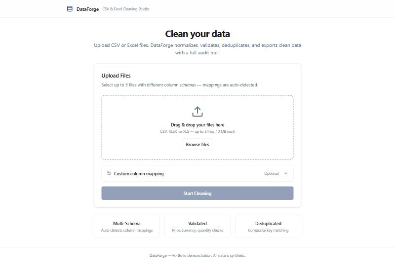
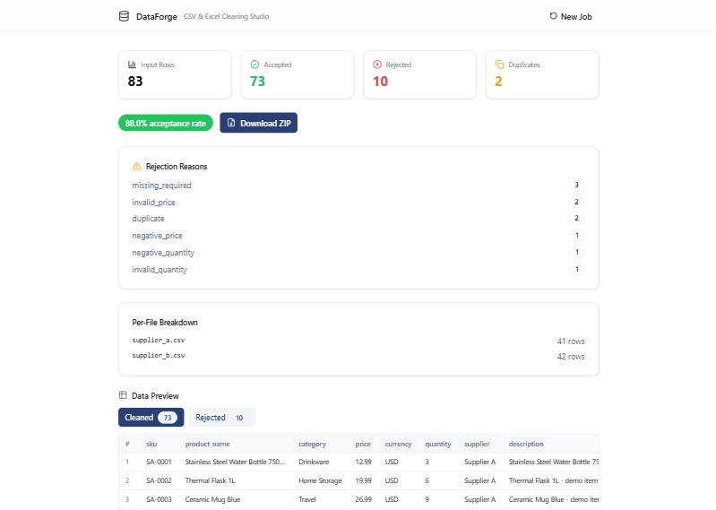
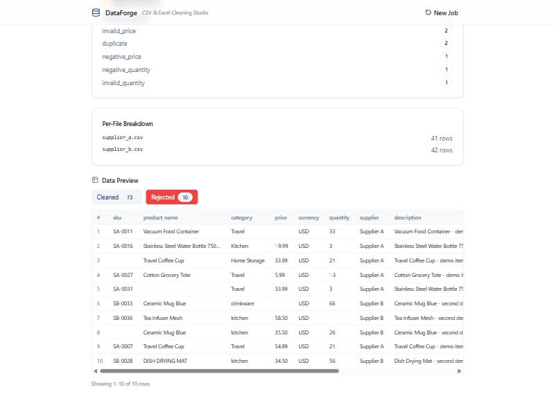
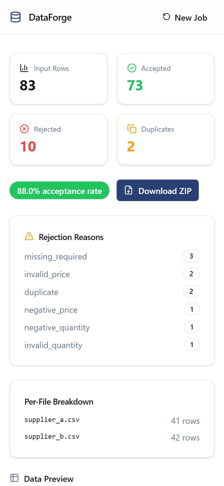

# DataForge

**CSV & Excel Data Cleaning Pipeline with REST API and React Dashboard**

DataForge automates the tedious work of cleaning messy supplier data. Upload CSV or Excel files with different column schemas, and DataForge normalizes, validates, deduplicates, and exports clean data — with a full audit trail showing exactly what was rejected and why.

> This is an independent portfolio project. All sample data is synthetic.



## The Problem

Teams that receive product data from multiple suppliers deal with inconsistent column names, mixed price formats (`$12.99`, `12,99`, `N/A`), missing required fields, and duplicate entries across files. Cleaning this manually is slow, error-prone, and impossible to audit.

## Features

- **Multi-schema ingestion** — CSV (auto-detected encoding) and Excel (.xlsx) files with different column layouts
- **Auto-detected column mapping** — resolves synonyms like `Item Code` → `sku`, `Vendor` → `supplier`
- **Price & currency normalization** — handles `$`, `€`, thousands commas; rejects ambiguous values
- **Decimal precision** — Python `Decimal` for monetary values, no floating-point drift
- **Row-level validation** — required fields, non-negative price/quantity, currency codes, with per-row reason codes
- **Composite-key deduplication** — configurable keys (`sku + supplier`), case-insensitive, first-wins
- **Source traceability** — every rejected row carries its original filename and row number
- **Row count reconciliation** — `input = accepted + rejected` enforced by assertion
- **REST API** — async job processing, streaming uploads, queue limits, and ZIP downloads
- **React dashboard** — drag-and-drop upload, real-time progress, paginated data preview
- **CSV formula injection protection** — all exported values are sanitized

## Screenshots

| Upload | Results | Rejected Records | Mobile |
|--------|---------|-----------------|--------|
|  |  |  |  |

## Technology Stack

| Layer | Technology |
|-------|-----------|
| Engine | Python 3.12+, pandas, Pydantic v2, Python Decimal |
| API | FastAPI, uvicorn, async job processing with ThreadPoolExecutor |
| Frontend | React 19, TypeScript, Vite, Tailwind CSS v4, TanStack Query |
| Testing | pytest (135 tests), Vitest + Testing Library (18 tests) |

## Architecture

```
┌─────────────────────────────────────────────────────────┐
│  React Frontend (Vite)                                  │
│  Upload → Progress Polling → Results + Data Preview     │
└──────────────────────┬──────────────────────────────────┘
                       │ /api/v1/
┌──────────────────────▼──────────────────────────────────┐
│  FastAPI REST API                                       │
│  Streaming upload │ Job queue │ Preview │ ZIP download   │
└──────────────────────┬──────────────────────────────────┘
                       │
┌──────────────────────▼──────────────────────────────────┐
│  Cleaning Engine (per file, then merge)                  │
│  Ingest → Map → Normalize → Validate → Deduplicate      │
└──────────────────────┬──────────────────────────────────┘
                       │
              cleaned.csv + rejected.csv
              + quality-report.json
```

## Getting Started

### Prerequisites

- Python 3.12+
- Node.js 20.19+ or 22.12+ and npm (required by Vite 8)

### Backend

```powershell
python -m venv .venv
.venv\Scripts\Activate.ps1
pip install -e ".[dev]"

# CLI — clean files directly
python -m dataforge --input sample_data/supplier_a.csv sample_data/supplier_b.csv --output output/

# API server
uvicorn dataforge.api:app --reload --port 8000
```

### Frontend

```powershell
cd frontend
npm install
npm run dev
```

Open [http://localhost:5173](http://localhost:5173). The frontend proxies API requests to port 8000.

### API Docs

With the backend running, visit [http://localhost:8000/docs](http://localhost:8000/docs) for interactive OpenAPI documentation.

## API Endpoints

| Method | Path | Description |
|--------|------|-------------|
| `GET` | `/health` | Health check |
| `POST` | `/api/v1/jobs` | Upload files and start a cleaning job |
| `GET` | `/api/v1/jobs/{id}` | Job status and statistics |
| `GET` | `/api/v1/jobs/{id}/report` | Quality report JSON |
| `GET` | `/api/v1/jobs/{id}/preview` | Preview cleaned/rejected rows |
| `GET` | `/api/v1/jobs/{id}/download` | Download results as ZIP |

## Testing

```powershell
# Backend (135 tests)
pytest tests/ -v

# Frontend (18 tests)
cd frontend
npm test

# Type check
npx tsc -b --noEmit

# Production build
npm run build
```

## Project Structure

```
src/dataforge/
├── cli.py              # CLI entry point
├── config.py           # Pydantic models for pipeline configuration
├── ingestion.py        # CSV/Excel reader with encoding detection
├── mapping.py          # Column synonym resolution and auto-detection
├── normalization.py    # Price, currency, quantity, whitespace cleanup
├── validation.py       # Required fields, type/range checks, reason codes
├── deduplication.py    # Composite-key duplicate detection
├── engine.py           # Pipeline orchestrator
├── reporting.py        # Output generation (CSV + JSON)
└── api/
    ├── routes.py       # REST endpoint handlers
    ├── schemas.py      # Request/response models
    ├── jobs.py         # In-memory job store with worker pool
    ├── services.py     # Job processing bridge
    └── security.py     # File validation, formula injection protection

frontend/src/
├── App.tsx             # 3-step state machine (upload → processing → results)
├── api/client.ts       # Typed API client
└── components/
    ├── DropZone.tsx     # Drag-and-drop file upload
    ├── JobProgress.tsx  # Real-time polling with progress bar
    ├── DataPreview.tsx  # Paginated data table with cleaned/rejected tabs
    └── ResultsSummary.tsx  # Stats, rejection reasons, per-file breakdown
```

## Known Limitations

- **In-memory job store** — jobs are lost on server restart; designed for local demonstration
- **No authentication** — API has no auth layer; not suitable for public deployment
- **Polling-based progress** — uses 1-second polling instead of WebSocket push
- **Single-process** — job queue runs in a thread pool within one process

## Sample Run

Using the included synthetic supplier data (83 rows across 2 files with different schemas):

```
Input rows:  83
Accepted:    73
Rejected:    10  (3 missing required, 2 invalid price, 2 duplicate,
                   1 negative price, 1 negative quantity, 1 invalid quantity)
Duplicates:  2
```

## License

This project is available for review as a portfolio demonstration.
